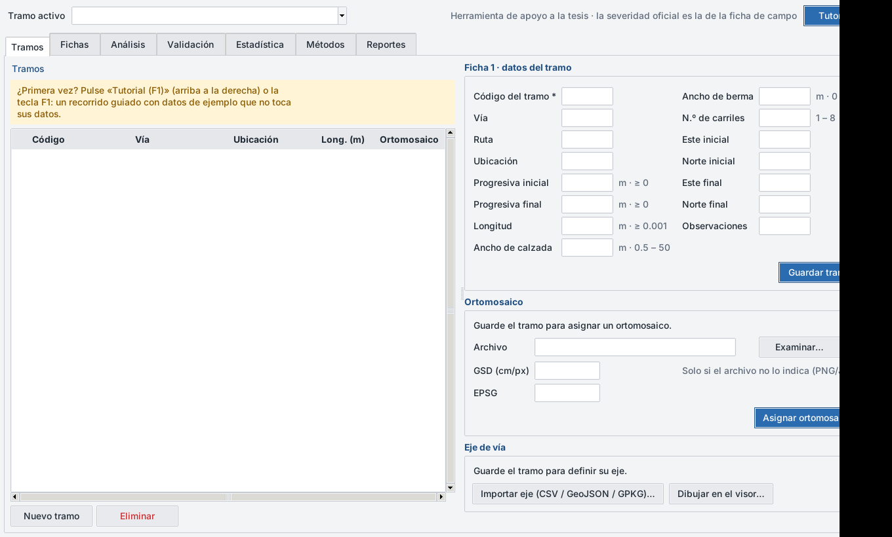
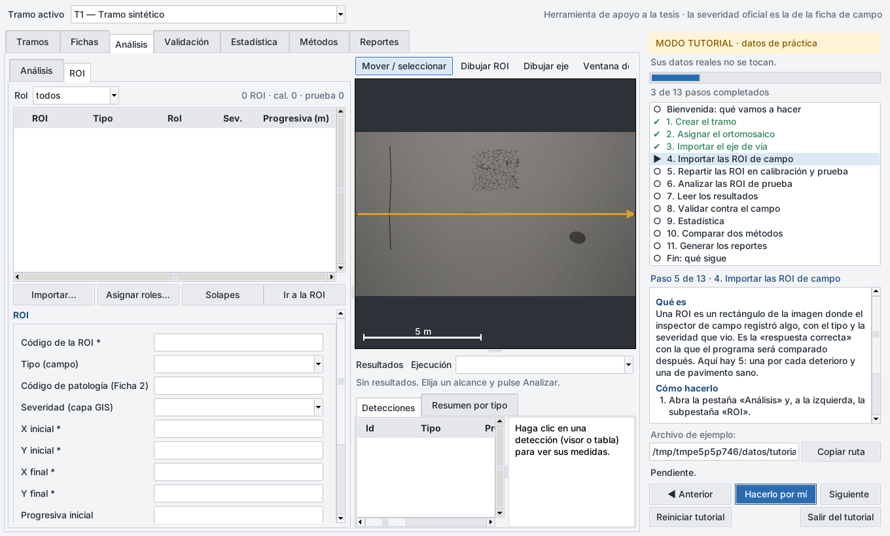

# Detección de deterioros en pavimentos flexibles (RGB) — herramienta de apoyo a la tesis

Tesis: *Metodología para la detección de deterioros y fallas estructurales en pavimentos flexibles de zonas
altoandinas mediante bandas RGB y procesamiento en Python* (UNSAAC, Cusco, 2026).

> Es una herramienta de **apoyo**. La severidad oficial es la de la ficha de campo; la `severidad_prelim` del
> programa es solo orientativa. Los umbrales calibrados con imágenes sintéticas son **provisionales**
> (ver `Params.provisionales()`): deben recalibrarse con los ortomosaicos reales antes de usarlos como evidencia.

## Estado: Fase 7 de 7 (algoritmo de Sun y comparación de métodos) — proyecto completo

Al final: **`CHECKLIST_TESIS.md`** (evidencia por módulo y objetivo, qué recalibrar con T1–T3, decisiones pendientes).

| Fase | Contenido | Estado |
|---|---|---|
| F1 | Plan, carpetas, esquema de BD | aprobada |
| F2 | Núcleo: motor modular, lectura por ventanas, ancho corregido, eje de vía local | hecha |
| F3 | Modelos de BD, `logica_*` de tramos/fichas/ROI/detección, importadores CSV/GeoJSON/GPKG | hecha |
| F4 | UI Tkinter/ttk + visor por ventanas + procesamiento en segundo plano | hecha |
| F5 | Validación (VP/FP/FN/VN), calibración de umbrales, estadística comparativa, gráficos | hecha |
| F6 | Reportes PDF/XLSX/CSV, exportación a QGIS (GPKG/GeoJSON), respaldo, registro, empaquetado, manual | hecha |
| **F7** | **Método 'sun' (Sun, 2009), comparación 'actual' vs 'sun' (pestaña Métodos + reportes), medición de tiempo y RAM** | **hecha (este código)** |

Ya existen `main.py`, la interfaz (`app/ui/`), `app/tareas.py`, `logica_validacion`, `logica_calibracion`, `logica_estadistica` y `graficos`. Desde la F6 también hay reportes, exportación a QGIS, respaldo y `MANUAL.md`. Desde la F7 existe el método **'sun'** (`app/nucleo/sun.py`), `logica_comparacion.py`, la pestaña **Métodos** y `scripts/comparar_rendimiento.py`.

## Modo tutorial (para usuarios nuevos)

El programa trae un **tutorial guiado dentro de la aplicación**, basado en el ejemplo sintético (imagen de 12 m con una grieta
transversal, una longitudinal, piel de cocodrilo, un bache y un trozo sano). Todo lo que necesita viaja con el proyecto.

**Cómo abrirlo (siempre disponible):**
- botón **Tutorial (F1)** arriba a la derecha de la ventana, o la tecla **F1**, o menú **Ayuda ▸ Tutorial guiado…**;
- al **abrir el programa con la base de datos vacía** se ofrece solo («Empezar», «Ahora no», «No volver a preguntar»); en la
  pestaña Tramos, mientras no haya tramos, un aviso recuerda dónde está;
- sin abrir el programa antes: **`tutorial.bat`** (Windows) · **`./tutorial.sh`** (Linux/macOS) · `python main.py --tutorial`.

**Qué hace:** un panel a la derecha recorre 13 pasos (tramo → ortomosaico → eje → ROI → roles → análisis → resultados →
validación → estadística → métodos → reportes). Cada paso explica **qué es**, **cómo hacerlo** y **qué debería ver**; se puede
hacer a mano o con **«Hacerlo por mí»** (el programa maneja las pestañas reales). El avance se reconoce mirando la base de
datos, así que funciona igual si el paso se hizo a mano. Trabaja en una **base de datos de práctica**
(`<carpeta de la BD>/tutorial/`): **los datos reales no se tocan**. «Salir del tutorial» vuelve a la base real; «Reiniciar
tutorial» borra la práctica y empieza de nuevo.

**Archivos del proyecto que lo hacen posible:**

| Ruta | Qué es |
|---|---|
| `ejemplo/` | Imagen sintética, `rois_ejemplo.csv` y `eje_ejemplo.csv` que usa el tutorial (ver `ejemplo/LEEME.md`). Si faltan, el programa los genera idénticos. |
| `scripts/generar_ejemplo.py` | `python scripts/generar_ejemplo.py ejemplo` regenera el ejemplo. |
| `prototipo/` | El prototipo original de un solo archivo (`pavimento_rgb.py`, `generar_ejemplo.py`, su salida y README), de donde salió el ejemplo. Solo referencia. |
| `tutorial.bat`, `tutorial.sh` | Lanzadores directos del tutorial. |
| `app/ejemplo_sintetico.py`, `app/logica_tutorial.py`, `app/ui/presentadores/p_tutorial.py`, `app/ui/panel_tutorial.py`, `app/ui/dialogo_tutorial.py` | Código. Pruebas: `tests/test_tutorial.py`. |

El tutorial necesita una base de datos en archivo (no `:memory:`) para poder volver a ella al salir. El ejecutable de PyInstaller
incluye `ejemplo/` (ver `pavimento_tesis.spec`).




## Instalación y pruebas

```
pip install -r requirements.txt
pytest                 # 437 con pantalla (xvfb-run -a pytest en Linux sin pantalla); las de Tk se omiten solas. ~3 min
xvfb-run -a pytest     # Linux sin pantalla: ejecuta también las 10 pruebas de widgets
pytest -m lento        # además: vía de 100 000 x 2 000 px con ambos métodos (~3 min), mide el pico de RAM
python -m scripts.comparar_rendimiento   # tiempo y RAM de 'actual' y 'sun', cada uno en un proceso aparte
python main.py [--bd RUTA]               # abre la aplicación (BD: --bd > $PAVIMENTO_BD > ./datos/pavimento.db)
xvfb-run -a -s "-screen 0 1440x900x24" python scripts/captura_pantallas.py   # recorre la UI y guarda capturas/ (requiere Pillow)
```
Requiere **Tkinter** y matplotlib/pandas (F5) (Windows: viene con Python; Linux: `sudo apt install python3-tk`). Pillow solo se usa en el script de capturas.

## Uso de la aplicación (F4)

`python main.py` abre la ventana (sin login). Arriba se elige el **tramo activo**; las pestañas lo comparten.

| Pestaña | Qué hace |
|---|---|
| **Tramos** | CRUD de la Ficha 1 (formulario generado desde `esquema_tramo`), asignar ortomosaico (GSD/EPSG si el archivo no los trae), eje de vía (importar CSV/GeoJSON/GPKG o dibujarlo en el visor) |
| **Fichas** | Vuelos, condiciones ambientales, GCP, catálogo, inspecciones y patologías (con geometría y severidad); importación CSV con vista previa |
| **Análisis** | Visor + panel **ROI** (lista, formulario, roles calibración/prueba, importación con vista previa) + panel **Análisis** (alcance, método, parámetros, Analizar/Cancelar) + tabla de detecciones, resumen por tipo y medidas de la detección elegida |

**Visor** (`app/ui/visor.py`): nunca carga el ortomosaico entero. Dibuja una miniatura (≤ 4 Mpx, calculada en un hilo) y
lee del archivo solo la zona visible, ya remuestreada al tamaño de pantalla (con GeoTIFF + rasterio la lectura decimada
usa las *overviews*: si el archivo no las tiene, créelas con `gdaladdo` o desde QGIS para acelerar la miniatura).
Herramientas: *Mover/seleccionar* (arrastrar; clic en una detección muestra sus medidas), *Dibujar ROI* (rectángulo),
*Dibujar eje* (clic = vértice; doble clic o Enter = terminar; Retroceso = quitar el último; Esc = cancelar), *Ventana de
análisis*. Rueda = zoom en el cursor; botón central = desplazar. Las detecciones usan `COLORES` del núcleo.
Medido con un GeoTIFF de 60 000 × 2 000 px: miniatura 1.7 s, zona 1:1 de 1200×840 px en 6 ms, zona decimada en 0.2 s.

**Segundo plano** (`app/tareas.py`): un hilo ejecuta SOLO `logica_deteccion.ejecutar_trabajo`; la UI sondea la cola con
`after` (100 ms) y, en el hilo principal, llama a `guardar_resultado` (o a `registrar_incidencia` si se canceló o falló).
Cancelar usa `threading.Event`. «Todas las ROI de un rol» encadena varios trabajos; si se cancela, el que corre se detiene
y los que esperaban se descartan. Los parámetros se editan en un diálogo con aviso PROVISIONAL y valen solo para la sesión.

## Uso de la validación, calibración y estadística (F5)

Pestañas **Validación** (sub-pestañas Validación · Referencias geométricas · Calibración) y **Estadística**; la lógica está en
`app/logica_validacion.py`, `logica_calibracion.py`, `logica_estadistica.py` y los gráficos (`Figure` de matplotlib, reutilizables
en el PDF de la F6) en `app/graficos.py`.

```python
from app import logica_validacion as lv, logica_calibracion as lc, logica_estadistica as le, logica_roi, logica_deteccion as ld
logica_roi.asignar_roles("T1", 0.5, 42)            # calibración / prueba (estratificado, reproducible)
ld.analizar_rois("T1")                              # una ejecución por ROI
res = lv.evaluar("T1")                              # ROI de prueba; guarda en Validacion (idempotente)
le.metricas_validacion(tramo="T1")                  # sens./esp./prec./exact. con IC de Wilson, F1 con IC bootstrap, kappa
plan = lc.preparar_calibracion("T1")                # solo ROI de calibración (hilo principal: lee la BD)
r = lc.ejecutar_calibracion(plan)                   # búsqueda (corre el motor; en la UI va en segundo plano). NO guarda
lc.aplicar_calibracion(r, confirmar=True)           # único punto que llama a guardar_params_base(calibrado=True)
```

**Unidad de análisis = (ROI, tipo)**: para cada ROI de prueba y cada uno de los 4 tipos se asigna exactamente una celda
VP/FP/FN/VN (vp+fp+fn+vn = 1).

| | referencia de campo: el tipo **sí** está | el tipo **no** está |
|---|---|---|
| **detectado** | VP | FP |
| **no detectado** | FN | VN |

- *Referencia de campo*: `ROI.tipo_campo` (+ `Patologia.presencia`: si todas las fichas del tipo dicen «No hay», el tipo se
  considera ausente; una ficha con presencia que equivalga a otro tipo lo añade). `'sano'` = ningún tipo presente.
  Severidad oficial = `Severidad` vía `logica_fichas.severidades_roi`.
- *Con `GeometriaReferencia`* (línea/polígono en px, pestaña «Referencias»): el `tipo_campo` de esa ROI se valida por **solape**
  (Dice entre máscaras, líneas con tolerancia `tolerancia_ref_m`); Dice ≥ `umbral_solape` → VP, si no FN. Sin geometría:
  presencia por ROI (método principal). Ambos umbrales están en `Configuracion` (`umbral_solape` 0.30, `tolerancia_ref_m` 0.10 m).
- *Roles*: solo las ROI de **prueba** cuentan y se guardan; las de calibración solo se evalúan para calibrar (`guardar=True` con
  `rol='calibracion'` es un error). Un solape calibración/prueba (`rois_solapados`) **bloquea** la validación y la calibración
  (`solapes='advertir'` solo avisa).
- *Casos límite*: ROI sin detección (FN o VN según la referencia), ROI `sano` (solo FP/VN), ROI sin ejecución que la cubra
  (se omite y se avisa), **división por cero → `None`** (nunca 0), **n < 5 → se calcula el IC pero se advierte que no es fiable**.
- *Estadística* (`logica_estadistica`): sensibilidad, especificidad, precisión y exactitud con IC 95 % de Wilson; F1 con IC
  bootstrap por unidades; kappa de Cohen (presencia, tipo multiclase, severidad observador 1 vs 2 y campo vs Python, con
  ponderación lineal) con el umbral `umbral_concordancia` de `Configuracion`; matrices de confusión; error de medidas contra
  la Ficha 4 (sesgo, MAE, RMSE, Bland-Altman, Pearson/Spearman, t pareada o Wilcoxon según Shapiro); Tablas 2-4 (conteo,
  longitud, ancho, área, % de área afectada por ROI y totales por tipo); McNemar entre dos conjuntos de ejecuciones validadas
  (p. ej. 'actual' vs 'sun', o antes/después de calibrar); **comparación descriptiva entre tramos** (`comparacion_tramos`:
  frecuencia, longitud/ancho/área con media, mín., máx. y DE, % de área afectada, frecuencias del tipo y la severidad de campo; sin
  inferencia, como pide el plan de tesis 5.5) y la columna «Concordancia (%)» de la Ficha 7 (= exactitud × 100).
- *Calibración*: búsqueda **por coordenadas** sobre una rejilla acotada (valor × {0.5…2}, recortado a `LIMITES`), objetivo F1 o
  kappa (`objetivo_calibracion`); tope de pasadas y de evaluaciones; se muestra antes/después; **no guarda nada** hasta
  `aplicar_calibracion(..., confirmar=True)`. Cada ejecución sigue guardando sus `Params` exactos.
- Todo lo calculado con ejecuciones PROVISIONALES lleva `provisional=True` y el rótulo PROVISIONAL (tablas, avisos y gráficos).

## Uso del núcleo

```python
from app.nucleo.lectura import abrir
from app.nucleo.parametros import Params
from app.nucleo.eje_via import EjeVia
from app.nucleo.pipeline import analizar_region

lector = abrir("tramo1.tif")                              # GeoTIFF: lectura por ventanas (rasterio)
p = Params(gsd_cm=0.5)
eje = EjeVia(vertices_px=[(0, 1000), (50000, 1200), (100000, 900)], gsd_m=p.gsd_m)   # polilínea del eje
res = analizar_region(lector, (0, 0, lector.ancho, lector.alto), p, eje=eje,
                      progreso=lambda f, t: print(f"{f:.0%} {t}"))
for d in res.detecciones:
    print(d.tipo, d.progresiva_m, d.longitud_m, d.ancho_mm, d.ancho_m, d.area_m2)
print(res.calidad)
```

`analizar_region` acepta un ROI (`(x0, y0, x1, y1)`) o el ortomosaico completo, un `threading.Event` para
cancelar y un `metodo` ('actual' o 'sun').

## Uso de la capa de datos (F3)

```python
from app import basedatos, logica_tramos, logica_importacion, logica_roi, logica_deteccion

basedatos.inicializar("datos/pavimento.db")                       # crea el esquema y siembra el catálogo
logica_tramos.crear_tramo({"codigo": "T1", "progresiva_ini_m": 0, "progresiva_fin_m": 1000})
logica_tramos.asignar_ortomosaico("T1", "orto_t1.tif")             # GeoTIFF: toma GSD, georreferencia y EPSG
logica_importacion.importar_eje("T1", "eje.gpkg")                  # capa de 1 línea exportada de QGIS
rep = logica_importacion.importar_rois("T1", "rois.gpkg", simular=True)   # vista previa; luego sin simular
logica_roi.asignar_roles("T1", proporcion_calibracion=0.5, semilla=42)    # reparto calibración / prueba
ejecuciones = logica_deteccion.analizar_rois("T1", rol="calibracion")
```

- Todas las funciones `logica_*` devuelven **diccionarios** (las vistas no importan modelos). Los errores de datos
  son `ErrorValidacion` (con `.errores = {campo: mensaje}`, todos juntos) o `ErrorNoEncontrado`.
- **Hilos**: `preparar_analisis` y `guardar_resultado` van en el hilo principal; `ejecutar_trabajo` (solo núcleo) es el
  que se pone en un hilo en la F4.
- **Importadores** (`logica_importacion`): ROI (CSV en px —formato del motor anterior—, CSV en coordenadas, GeoJSON,
  GPKG), eje de vía, fichas (`vuelo`, `condicion`, `gcp`, `catalogo`, `inspeccion`) y patologías (F2+F3+F4 en un CSV).
  `simular=True` es una vista previa fiel (deshace todo); `estricto=True` (defecto) no importa nada si una fila falla.
  CSV: UTF-8 o Windows-1252, separador `,` `;` o tab, coma decimal. Capas: se convierten al EPSG del ortomosaico
  (4326 ↔ UTM WGS84, en Python puro, error < 1 mm contra pyproj).

## Qué se verificó (datos sintéticos; no hay aún datos reales)

| Criterio | Resultado |
|---|---|
| Ortomosaico de 100 000 × 2 000 px (GeoTIFF real, rasterio) | pico **635 MB** de RAM, 42 s, 10/10 grietas |
| Mismo tamaño, lector sintético sin archivo | pico **545 MB**, 52 s |
| Ancho de grieta, anchos conocidos 15–60 mm (3–12 px) | error ≤ 2 mm (< 0.4 px), con contraste alto y bajo |
| Ancho en el límite de 2 px (10 mm) | sobrestima ~2 mm (límite del método); < 2 px se marca «no resoluble» |
| Piel de cocodrilo | ya no reporta `ancho_mm` (antes 1695); reporta área, n.º de celdas, densidad |
| Eje con curva en L | clasificación correcta con ángulo local; el ángulo único (motor anterior) clasifica mal |
| Calidad de imagen sintética nítida | «Adecuada» (antes «No adecuada» por un umbral de nitidez en 20) |
| Mismo resultado con teselas de 1000 / 600 px y con una sola | longitudes, anchos, áreas y celdas coinciden |

### Sobre el «1.6x» de sobreestimación del ancho
En `generar_ejemplo.py` las polilíneas de grosor 5 y 4 se dibujan realmente con **35.1 y 25.0 mm** (área
dibujada / longitud), no 25 y 20 mm. Contra esa verdad, el motor anterior sobrestimaba ~1.15–1.2x
(40 y 29–31 mm) y el método nuevo da 34.7 y 25.0 mm. Con grietas sintéticas de ancho exacto el sesgo del
motor anterior era de +2 a +4.5 mm (≈ 0.5–1 px).

### Verificación de la F3
| Criterio | Resultado |
|---|---|
| UTM ↔ WGS84 (`crs.py`) frente a pyproj, 400 puntos aleatorios en 3 zonas | error máx. 0.0002 mm (directo) y 0.003 mm (ida y vuelta) |
| GeoPackage y GeoJSON escritos por GDAL (`tests/datos/oraculo.*`) | se leen con polígonos con agujero, multilíneas y puntos |
| ROI importada en WGS84 desde GeoJSON sobre un GeoTIFF UTM 32719 | coincide con la ROI en píxeles (±1 px) |
| Importación estricta / parcial / simulada | atómica; la simulación no deja rastro |
| Análisis de punta a punta (CSV → BD → detecciones) sobre las 5 ROI sintéticas | R01 transversal, R02 longitudinal, R03 piel de cocodrilo, R04 bache, R05 sin detecciones |
| Ejecución guardada con sus `Params` (JSON) | reproducible; marcada `provisional` hasta calibrar |

## Verificación de la F4
| Criterio | Resultado |
|---|---|
| `pytest` completo | **186 pasan** (142 anteriores + 44 nuevas); sin pantalla: 178 pasan y 8 se omiten |
| Ventana con DISPLAY virtual (xvfb) | abre, recorre las 3 pestañas, analiza ROI sintéticas desde la UI y selecciona detecciones con eventos de ratón reales |
| La UI no se congela | prueba con un trabajo lento: `analizar()` vuelve en < 0.5 s y el bucle de Tk sigue latiendo (huecos < 0.5 s) |
| Cancelar | detiene el hilo, deja una ejecución `cancelada` en la BD y restablece los botones |
| Capas | prueba AST: `app/ui` no importa `modelos`, `basedatos`, `sqlalchemy` ni `nueva_sesion`; presentadores y modelo del visor no importan Tk; `tareas.py` no importa Tk ni BD |
| Capturas | `capturas/*.png` (9 vistas) |

### Error encontrado y corregido en la F4
`<<TreeviewSelect>>` de Tk se entrega de forma **asíncrona**: una bandera «silencio» no basta y un cambio hecho por programa
disparaba el callback tarde, borrando el formulario (p. ej. al dibujar una ROI). `TablaTreeview` compara ahora con la
selección ya conocida (`widgets.py`; cubierto por `test_ui_humo.py`). No se modificó el núcleo ni `logica_*`.

## Verificación de la F5
| Criterio | Resultado |
|---|---|
| `pytest` completo | **259 pasan** con pantalla virtual (186 anteriores + 73 nuevas); sin pantalla: 248 pasan y 10 se omiten |
| Wilson | igual a `statsmodels.proportion_confint(method='wilson')` (k=0, k=n, n=0, n pequeño; 95 y 99 %) |
| Sens./espec./precisión/exactitud/F1 | iguales a `sklearn.metrics` sobre 200 casos aleatorios |
| Kappa | = `cohen_kappa_score` (sin pesos, lineal y cuadrático); casos conocidos: **1** (acuerdo total), **0** (azar), **−1**; `None` si pe = 1 |
| Matriz de confusión | = `sklearn.metrics.confusion_matrix` |
| Bland-Altman | sesgo conocido (diferencias 1,2,3,2,1,3 → sesgo 2), DE y límites de acuerdo calculados a mano; IC del sesgo con t |
| Pearson/Spearman/Shapiro/t/Wilcoxon | iguales a `scipy.stats`; Wilcoxon se elige solo si Shapiro rechaza normalidad |
| McNemar | = `statsmodels.mcnemar` (exacto si b+c < 25, χ² con corrección en otro caso) |
| VP/FP/FN/VN | casos forzados con ejecuciones y detecciones construidas a mano (cada celda, ROI `sano`, ROI sin detecciones) y de punta a punta con el motor real sobre la imagen sintética |
| Solape por geometría | Dice = 1 (iguales), 0 (disjuntas), 0.5 (cuadrados desplazados la mitad); tolerancia y umbral configurables |
| Calibración | búsqueda con óptimo conocido; con el motor real mejora F1 0.80 → 1.00 en las ROI de calibración; **verificado que jamás se corre el motor sobre una ROI de prueba** y que no se guarda nada sin confirmar |
| UI | recorrido con xvfb: validar, errores de formulario, geometrías, estadística, comparación y calibración en segundo plano con confirmación; capturas `capturas/09…15` |
| Capas | `test_ui_capas.py` sigue en verde con las vistas y presentadores nuevos; `tareas.py` sigue sin Tk ni BD |

### Error encontrado y corregido en la F5 (código de la F4)
El visor trataba como polígono solo `geom_tipo == "poligono"`, pero la fusión de zonas entre teselas emite `"poligono_aprox"`
(envolvente convexa), que se dibujaba y seleccionaba como línea. Ahora se usa `startswith("poligono")` en `visor.py` y
`visor_modelo.py`; prueba `test_zonas_poligono_aprox_se_tratan_como_poligono`. El núcleo y `logica_*` previos no cambiaron;
solo se **añadieron** claves de `Configuracion` (`umbral_solape`, `tolerancia_ref_m`, `objetivo_calibracion`) y `app/tareas.py`
ganó `Calculo`/`gestor_de_calculos` sin tocar `GestorTareas`.

## Uso de reportes, exportación y respaldo (F6)
Flujo completo en `MANUAL.md`; instalación y `.exe` en `INSTALACION.md`. Pestaña **Reportes**: PDF / Excel / CSV del tramo activo
(vista previa antes de generar), exportación a GeoPackage/GeoJSON para QGIS y respaldo/restauración de la base de datos.
Los tres tramos de la tesis (≈ 1.2 km) se registran como **T1, T2 y T3**. Los **falsos positivos se excluyen del conteo** de las
Tablas 2-4 pero siguen registrados en `Validacion` y en las detecciones (`incluida_en_conteo`, `estado_validacion`).

## Uso del método 'sun' y de la comparación (F7)
- En **Análisis** elija el método `sun` (o `actual`). Con `sun` el resultado sale siempre **PROVISIONAL** y solo reporta grietas
  longitudinales/transversales (Sun no trata piel de cocodrilo ni baches).
- Pestaña **Métodos**: «Analizar y validar con ambos» corre `actual` y `sun` sobre las **mismas ROI de prueba** con los **mismos Params base**,
  valida cada uno contra la referencia de campo y compara. «Comparar lo ya validado» solo compara. La tabla muestra métricas por método y
  tipo, tiempo (s y s/Mpx) y RAM; debajo, una conclusión **construida solo con las cifras** (nunca dice «mejor» sin mostrar el número).
- Los reportes (PDF/XLSX) incluyen, si ambos métodos están validados, las hojas «Métodos Métricas / McNemar / Medidas / Rendimiento».
- `python -m scripts.comparar_rendimiento [--ortomosaico T1.tif --gsd-cm 0.8 --region x0 y0 x1 y1]`: mide tiempo y pico de RAM con un proceso por método.
- **Parámetros** (`Params`, versión 2): `sun_alfa=0.2247`, `sun_beta=40` (constantes del **código** Matlab; el texto de la tesis dice 0.22 y 45),
  `sun_contraste_min`, `sun_vecinos_superficie` y cinco distancias `sun_*_m` derivadas del GSD. Todos PROVISIONALES.
  Las ejecuciones guardadas con la versión 1 conservan su versión y su huella; se leen sin cambios.

## Verificación de la F7
| Criterio | Resultado |
|---|---|
| `pytest` completo | **417 pasan** con pantalla virtual (+ 2 `lento`: vía de 100 000 × 2 000 px con ambos métodos, ejecutadas aparte con los resultados de abajo) |
| Contra una transliteración literal del Matlab y una referencia independiente (numpy puro) de la manta fractal | idénticos (`tests/test_sun.py`) |
| Imágenes sintéticas con grietas de ancho/longitud conocidos | transversal 4.475 m (actual 4.487 m), longitudinal 5.517 m (actual 5.472 m) en el ejemplo sintético; anchos dentro de tolerancia |
| `kmin` y media globales independientes del tamaño de tesela | igualdad exacta del contexto con teselas de 2400 a 512 px; detecciones dentro de tolerancia (las grietas que cruzan el borde de tesela pierden fragmentos < 15 cm, limitación previa del pipeline y común a ambos métodos) |
| Memoria 100 000 × 2 000 px (200 Mpx), `tesela_px=2048` | **actual: 491 MB pico, 74 s; sun: 459 MB pico, 100 s**; ambos detectan las 10 grietas transversales de 20 mm (límite 2 048 MB) |
| Comparación | misma referencia, mismos Params (misma huella), McNemar, Bland-Altman, rendimiento; `test_comparacion.py`, `test_ui_f7.py` |
| Capas | `test_ui_capas.py` sigue en verde (vistas/presentadores no importan modelos ni sqlalchemy); la BD se escribe solo en el hilo principal |

## Supuestos y límites conocidos (F7)
- **Supuesto:** las distancias de Sun en píxeles (5, 2, 6, 4, 30 px) se pasaron a metros asumiendo imágenes de ≈ 0.8 cm/px (`sun_*_m`). Confirmar con la resolución de las imágenes de Sun / con su GSD real.
- **Constantes del código, no del texto:** 0.2247 y 40 (decisión del tesista). Son PROVISIONALES hasta calibrarlas con T1–T3.
- **Relleno de ceros** fuera del bloque 3×3 (fiel al Matlab): k crece con el nivel de gris y T ≈ 0.9 × (tono más oscuro) + 40.
- **Mejora no pedida por Sun (aceptada por el tesista):** tope `T ≤ media − sun_contraste_min`. Sin él, una ROI sin grietas se marcaba entera como grieta. Si actúa, se advierte. `sun_contraste_min=0` reproduce el comportamiento original.
- **No se portaron los errores del Matlab** (limpieza de ruido que cruza `row(i)/col(j)`, `BW` sin definir, límites 425/480 y franjas de 40/20 px de imágenes de 480 px, 3 líneas de barrido): la conexión de rupturas se reescribió con tamaños derivados del GSD y sirve para cualquier orientación; la clasificación usa el eje de vía.
- `kmin` se resuelve **por región analizada** (ROI, ventana o tramo), no por tesela; una ROI y el tramo completo pueden tener distinto `kmin` y por tanto distinto T.
- 'sun' solo detecta grietas lineales: la comparación se restringe a los tipos comunes.
- La **RAM** de la pestaña Métodos es el aumento del RSS del proceso durante el análisis: aproximada y sensible al orden de ejecución. La cifra rigurosa sale de `scripts.comparar_rendimiento`.
- Con pocas unidades (< 10) McNemar tiene muy poca potencia y el texto lo dice; los datos siguen siendo sintéticos: **ninguna cifra de comparación es evidencia** hasta usar T1–T3.

## Verificación de la F6
| Criterio | Resultado |
|---|---|
| `pytest` completo | **353 pasan** con pantalla virtual (338 sin pantalla + 15 de UI que se omiten sin ella) |
| PDF / XLSX / CSV | se regeneran y se **reabren** (PDF con texto extraíble, XLSX con openpyxl sin fórmulas rotas, CSV UTF-8 con BOM y variante `;`) |
| GeoPackage | escrito con sqlite3 (sin GDAL) y releído con `leer_gpkg`, **pyogrio** y **geopandas**; CRS del ortomosaico; modo píxeles con srs_id −1 |
| Conclusiones del reporte | plantillas con cifras calculadas; PROVISIONAL primero; sin validación no se emiten conclusiones de desempeño |
| Respaldo | API de copia de SQLite; restauración deja `_antes_de_restaurar`; copia automática diaria con rotación solo de las automáticas |
| UI | recorrido con xvfb y motor real; capturas `capturas/16…18`; `test_ui_capas.py` sigue en verde |
| Empaquetado | `pyinstaller pavimento_tesis.spec` **compila en Linux** (carpeta de ≈ 500 MB) y el ejecutable abre y crea su registro bajo xvfb; **no probado en Windows** |

### Error encontrado y corregido (código de la F5)
La leyenda de la gráfica de métricas perdía series cuando la primera barra era «n/d» (usaba los manejadores de la primera serie).
Ahora se construye con `Patch` y hay la prueba `test_leyenda_de_metricas_tiene_las_cuatro_aunque_la_primera_barra_sea_nd`.

## Supuestos y límites conocidos (F6)
- **Supuesto:** columnas de la Ficha 7 y de las Tablas 2-4 según el capítulo 3.2 leído del plan; confirmar con su asesor.
- **Supuesto:** PDF con fuente Helvetica (WinAnsi); se sustituyen caracteres fuera de ese conjunto.
- Solo se exportan CRS WGS84 y UTM WGS84 (EPSG 4326, 326xx, 327xx); otro EPSG se rechaza con un mensaje claro.
- Sin georreferenciación solo se exporta en coordenadas de imagen (sin superposición en QGIS).
- Nombres, ubicación y progresivas de T1-T3 son datos que usted debe cargar; el programa no los inventa.
- Los datos siguen siendo sintéticos: **ninguna cifra de los reportes es evidencia** hasta calibrar con ortomosaicos reales.

## Supuestos y límites conocidos (F5)
- **Plan de tesis leído después de entregar la primera versión** (`PLAN_DE_TESIS_…FINALFINAL`): confirma que los indicadores de
  detección son «Número detectado, Falsos positivos, Falsos negativos y Concordancia de detección (%)» (Ficha 7), que el análisis es
  **descriptivo y comparativo entre los tres tramos «sin inferencias estadísticas que excedan el alcance»** (5.5) y que el kappa de
  Cohen se menciona solo para la concordancia entre dos observadores (5.3). Por eso se añadió `comparacion_tramos` y la columna
  «Concordancia (%)». Wilson, bootstrap, McNemar, Bland-Altman y t/Wilcoxon se mantienen porque se pidieron, pero **van más allá del
  plan**: úselos como apoyo y consulte al asesor antes de ponerlos en el texto.
- **Decisiones del tesista (8-nov-2026)**: (1) la concordancia de detección se presenta **en porcentaje** (se mantiene (VP+VN)/total ×100
  por ROI y tipo); (2) **kappa mínimo aceptable = 0.60** (ya era el valor por defecto de `umbral_concordancia`); (3) **por ahora solo
  se muestran los IC de Wilson**: McNemar, Bland-Altman, correlaciones, pruebas pareadas y el IC bootstrap del F1 siguen
  calculándose en `logica_estadistica` pero la UI los oculta salvo activar «Mostrar pruebas avanzadas» (`Configuracion['estadistica_avanzada']`,
  desactivado por defecto); (4) son **tres tramos de ≈ 1.2 km**; (5) **los FP/FN no entran al conteo por objeto pero se registran**:
  se guardan en `Validacion` por ROI y tipo; no se agrega modo de conteo por objeto.
- **Aún pendiente de confirmar con la tesis**: el plan no define la fórmula exacta de «Concordancia de detección (%)» (se asumió
  (VP+VN)/total por ROI×tipo; el tesista indicó solo «por porcentaje»), y solo ubica ROI donde
  el campo registró un deterioro (las ROI `sano` de la herramienta son una extensión). La Ficha 7 es una imagen sin texto en el
  documento, así que sus columnas no se pudieron contrastar.
- **SUPUESTO — unidad de análisis (ROI × tipo)** con una sola celda por unidad; una detección mal ubicada (Dice < umbral) cuenta
  como FN y **no** como FP adicional. Con ROI rectangulares y presencia por ROI, VN/FP dependen de cuántos tipos se evalúan.
- **SUPUESTO — tipo dominante de Python por ROI** (para la matriz de tipo): el tipo con más detecciones (empate: mayor área).
- **SUPUESTO — severidad por ROI** = la peor registrada por observador / la peor entre las grietas de Python con ancho resoluble.
  La severidad de Python es orientativa y solo existe para grietas lineales.
- **SUPUESTO — pares de medidas**: se comparan solo ROI×tipo donde Python detectó el tipo y la Ficha 4 tiene el dato; longitud y
  área se suman por ROI y tipo, el ancho es el promedio (bache: m → mm). Los no detectados ya cuentan como FN.
- **SUPUESTO — % de área afectada** = Σ área detectada / área de las ROI analizadas (las regiones no deben solaparse).
- **SUPUESTO — rejilla de calibración**: factores y `LIMITES` por parámetro son de ingeniería, no del plan de tesis; el ancho de
  grieta no se calibra aquí (se afina con la Ficha 4). Con pocas ROI de calibración (< 5) el ajuste se advierte como sobreajustable.
- Umbral de concordancia 0.60 (kappa), umbral de solape 0.30, tolerancia 0.10 m: valores por defecto **por confirmar con el asesor**.
- IC de kappa: error estándar asintótico simple (solo sin ponderar); IC de F1: bootstrap percentil (2000 réplicas, semilla fija).
- El cálculo estadístico es de milisegundos y corre en el hilo principal; solo la calibración (corre el motor) va por `tareas`.
- Los datos son sintéticos: **ninguna cifra de la F5 es todavía evidencia**; todo se rotula PROVISIONAL hasta calibrar con datos reales.
- Probado en Linux con xvfb y Python 3.12; no probado en Windows ni macOS.

## Supuestos y límites conocidos (F4)
- **No llegaron adjuntos el plan de la F1 ni la cervecera**: `estilos.py`, `widgets.py`, `ventana_principal.py` y
  `dialogo_reporte.py` están escritos desde cero siguiendo lo pedido (ttk, tema `clam`, sin ttkbootstrap ni paleta de
  cervecería). **Supuesto**: `dialogo_reporte.py` se usa como diálogo de informe de importación (vista previa/confirmar),
  porque en la F4 aún no hay reportes (F6). Si quiere conservar el aspecto de la cervecera, pásela y se adapta.
- **Validación por etapas en `logica_*`**: los formatos de un formulario se informan todos juntos, pero las reglas que
  dependen de la BD (código no está en el catálogo, ROI de otro tramo, «tipo obligatorio» de la ROI) las comprueba la
  lógica en una etapa posterior. Los presentadores unen las etapas donde es posible (patología + geometría + severidad;
  tipo de ROI); el resto aparece tras corregir los formatos.
- Los parámetros editados en el diálogo valen para la sesión; solo la calibración confirmada (F5) los guarda como base.
- Los nodata del ortomosaico se ven negros en el visor. Un TIFF de 1–2 bandas o sin 3 bandas RGB se rechaza con mensaje.
- Sin rasterio, el visor usa el lector OpenCV del núcleo (decodifica la imagen completa; tope de 120 Mpx).
- Botón central = desplazar; en macOS el botón central/derecho puede numerarse distinto (no probado en macOS).
- Probado en Linux con xvfb y Python 3.12/Tk 8.6; **no probado en Windows** (se llama a `SetProcessDpiAwareness` solo allí).
- Al cerrar con un análisis en curso se cancela y espera hasta 8 s para registrar la incidencia.
- Cambiar de base de datos desde el menú exige que no haya análisis en curso.

## Supuestos y límites conocidos (F3)
- **Catálogo de patologías (Ficha 2)**: solo se siembran 4 códigos con equivalencia en el motor (`GLO`, `GTR`, `GPC`,
  `HUE`). **Supuesto** a confirmar: que esos códigos y significados son los de tu ficha. Los otros 17 se cargan con
  `importar_fichas('catalogo', csv)`.
- **Anchos de la Ficha 4 en mm** (también en baches); las detecciones guardan `ancho_m` solo para baches.
- **ROI**: el motor analiza el rectángulo envolvente; el polígono (si es una ROI rotada) se guarda solo como registro.
- `ROI.severidad_campo` es la copia de la capa GIS; la severidad **oficial** es la tabla `Severidad` (Ficha 3).
- `pct_area_afectada` = área de la detección / área de la ROI (solo si la detección cae en una ROI).
- Un PNG/JPG no tiene georreferenciación: solo admite ROI/eje en píxeles (`sistema='px'`).
- Sin migraciones aún (esquema v1): un cambio de esquema en fases futuras exigirá migrar o recrear la BD.
- CRS distintos de 4326 y WGS84/UTM (PSAD56, SIRGAS…) no se convierten: se pide reproyectar en QGIS.
- `umbral_concordancia` (kappa mínimo) viene en 0.60 por defecto: **confirmar con el asesor**.

## Supuestos y límites conocidos (núcleo, F2)
- **Longitud representativa de grietas** (piel de cocodrilo) = longitud total de grietas dentro de la zona.
- **Severidad**: de grietas lineales solo orientativa, con los criterios de la Ficha 3 (≤1 / 1–3 / >3 mm). A 0.5 cm/px
  el ancho no se resuelve por debajo de ~2 px (10 mm), así que casi toda grieta detectada saldrá «Alta»: los
  umbrales son configurables. Cocodrilo y baches no se estiman (criterios cualitativos / profundidad).
- **`ancho_sigma_px = 0.9`** (corrección de difuminado) está calibrado con sintéticos: debe contrastarse con
  mediciones de fisurómetro de la Ficha 4.
- Sin eje de vía el análisis asume eje horizontal y lo advierte.
- Una grieta fragmentada por bajo contraste sale en varias detecciones.
- El lector sin rasterio (OpenCV/Pillow) decodifica la imagen **completa**: se rechaza por encima de 120 Mpx
  con instrucciones para usar rasterio o convertir a GeoTIFF con teselas desde QGIS.
- Tesela mínima = 512 px o el doble del margen de contexto (1 m por defecto).
